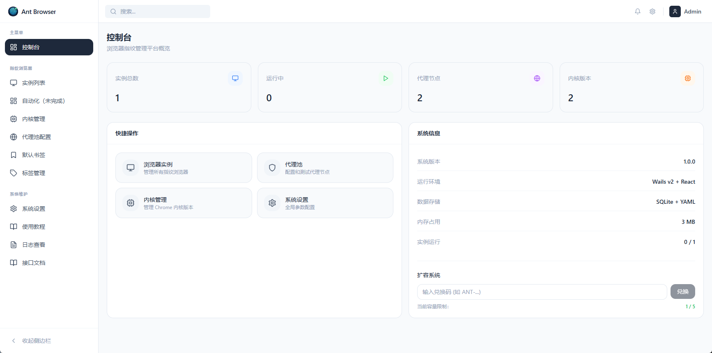
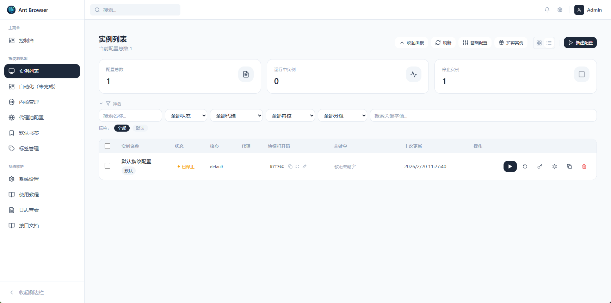
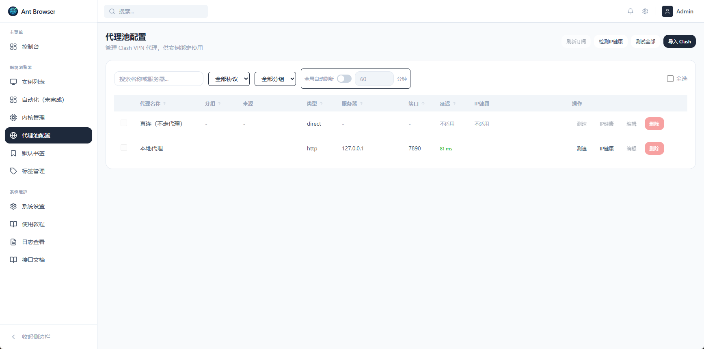
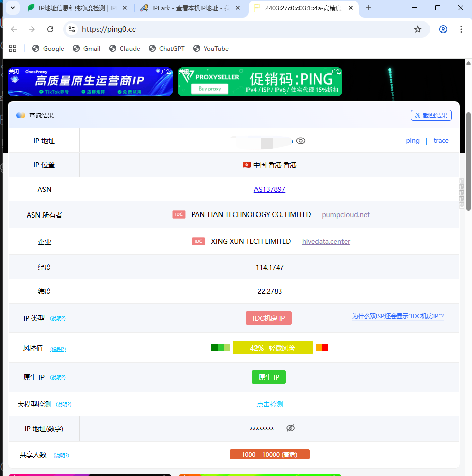

<div align="center">


# Ant Browser (蚂蚁浏览器)

**面向多账号深度隔离、全协议代理绑定与防关联指纹对抗的现代化桌面浏览器管理工具**

[](https://github.com/520qianjiawen/Ant-Browser-master/releases)
[](https://github.com/520qianjiawen/Ant-Browser-master/releases)
[](https://golang.org)
[](https://wails.io)
[](https://reactjs.org)
[](https://github.com/520qianjiawen/Ant-Browser-master/issues)
[](#-license)

<p align="center">
  <a href="#-核心特性">核心特性</a> •
  <a href="#-界面预览">界面预览</a> •
  <a href="#-推荐内核">推荐内核</a> •
  <a href="#-代理连接栈架构">代理连接栈</a> •
  <a href="#-快速开始">快速开始</a> •
  <a href="#-常用操作与快捷键">常用操作</a> •
  <a href="#-备份与迁移">备份与迁移</a> •
  <a href="#-开发者指南">开发者指南</a> •
  <a href="#-常见问题-faq">常见问题</a>
</p>

</div>

---

## 📖 项目简介

**Ant Browser** 是一款专为跨境电商多店铺运营、社媒多账号矩阵、独立站出海营销、隐私隔离测试及多实例自动化设计的**本地化桌面指纹浏览器**。

与依赖中心化云端服务器的传统商业防关联浏览器不同，Ant Browser 始终坚持**“数据本地化、自主可控、极简高效”**的设计哲学：

- 🔒 **数据绝对自主**：所有实例配置、Cookie、本地存储和浏览历史均保存在本机，绝不强制同步上传至第三方云端；
- 🌐 **原生双连接栈代理**：内置 `xray` + `sing-box` 组合栈与独立 `mihomo` 栈，全协议通杀并杜绝直连泄露；
- 🛡️ **深层指纹防关联**：支持原生指纹内核与 SunBrowser 生态内核，全方位注入硬件特征与随机噪声；
- 📍 **Auto-Geo 智能联动**：基于出口 IP 自动识别并适配实例语言、国家地区与时区，防漏网阻断保护；
- 🤖 **自动化友好**：标准 CDP 远程调试端口与外部 RESTful Launch API，无缝串接 Playwright、Puppeteer 与 Selenium。

---

## ✨ 核心特性

### 1. 深度环境隔离与防串号
- **独立环境存储**：每个浏览器实例分配完全独立的 `User Data` 目录，存储、IndexedDB、缓存、Service Worker 和 Cookie 彻底物理隔离，互不串扰。
- **一键克隆与迁移**：支持将运行环境打包导出为 ZIP，在新设备一键导入还原，保持环境完全一致。

### 2. 底层级指纹伪装与对抗
- **多维度指纹矩阵**：支持 Canvas 噪声、WebGL Vendor/Renderer 伪装、AudioContext 音频指纹保护、ClientRects 杂波注入。
- **真实硬件与网络环境模拟**：自定义 User-Agent、平台标识 (Platform/OS)、屏幕分辨率、硬件并发数 (CPU 核心数)、设备内存大小 (RAM)、系统语言与 WebRTC 局域网/公网 IP 防泄漏。
- **字体与跨平台对齐**：智能处理宿主字体与跨平台差异，杜绝因中文字体缺失造成的方块字与异常指纹特征。

### 3. 双连接栈全协议代理体系
- **双栈架构**：提供 `xray`（Xray + sing-box 组合栈）与 `mihomo`（独立 Mihomo 栈）两套完整连接栈。
- **主流协议全覆盖**：全面支持 VMess、VLess、Trojan、Shadowsocks、Hysteria2、TUIC、AnyTLS 以及 HTTP / SOCKS5 链式代理与 Clash 订阅导入。
- **出口防泄漏保护**：严格区分连接栈，代理连通性探测异常时**保留代理路径、坚决不回退直连**，从源头防止真实 IP 曝光导致账号关联封禁。

### 4. Auto-Geo 出口自动探测与地理适配
- **出口 IP 实时探针**：实例启动时通过目标代理隧道发起出口探测，精准获取归属地、ASN 及运营商信息。
- **多语言与时区自动对齐**：根据探测到的出口国家代码，自动同步调整浏览器实例的 `Accept-Language`、默认语言和系统时区，无需人工繁琐设置。

### 5. 扩展插件持久化与油猴脚本
- **插件全生命周期管理**：支持 Chrome 扩展离线包（`.crx` / 解压目录）导入与单实例绑定配置。
- **重启自愈**：支持实例关闭重启后自动恢复扩展包安装与配置，保证小助手、截图脚本与翻译插件长期稳定运行。

### 6. 实例窗口管理与高效交互
- **独立任务栏图标与数字角标**：Windows / macOS 运行实例自带独立窗口图标与 1-10 / A-Z 识别角标，多开时一目了然。
- **`Ctrl + K` (Mac `Cmd + K`) 快捷启动器**：全局瞬时唤出搜索框，支持按 Code 打开码、实例名称、分组或标签快速定位并启动实例。

### 7. 企业级安全备份与灾备恢复
- **多端同步渠道**：支持 本地存档、OpenList (Alist 挂载) 以及 AWS S3 兼容对象存储（MinIO、Cloudflare R2 等）。
- **敏感凭据物理隔离**：Token 及密钥仅保存在本地未跟踪文件 `backup.local.yaml`，界面默认脱敏显示，绝不随配置文件或备份包泄露。

---

## 🖼️ 界面预览

| 首页控制台 | 实例列表与筛选 |
|:---:|:---:|
|  |  |
| **代理池配置与测速** | **出口验证与防关联检测** |
|  |  |

---

## 🧩 推荐内核

代理底层运行时（Xray / sing-box）已随仓库内置提供，日常运行仅需配置浏览器内核：

### 1. 首推指纹内核：fingerprint-chromium（推荐）
Ant Browser 深度优化适配开源项目 [fingerprint-chromium](https://github.com/adryfish/fingerprint-chromium)。该内核在底层对 Chromium 源码进行了指纹防护补丁编译，提供原生的防关联能力。
- **下载地址**：[fingerprint-chromium Releases](https://github.com/adryfish/fingerprint-chromium/releases)
- **配置方法**：下载对应系统版本的解压包，解压至本地目录后在 `内核管理` 中添加并选定即可。

### 2. 兼容内核：SunBrowser (AdsPower 内核)
- 支持 SunBrowser 内核生态识别与一键下载；
- 启动时自动过滤非通用参数，保留核心代理隧道、数据目录隔离与 CDP 调试通道。

### 3. 通用 Chromium / 绿色 Chrome
- 支持直接指定本机已安装的绿色版 Chrome 或 Chromium，确保目录下包含对应系统的二进制可执行文件即可。

> **建议目录规范**：
> ```text
> chrome/
> └── chrome-142/
>     ├── chrome.exe (或 macOS/Linux 可执行文件)
>     └── ...
> ```

---

## 🌐 代理连接栈架构

为保证网络协议的绝对兼容与稳定性，Ant Browser 实现了清晰的双连接栈体系（在 `系统设置 > browser.default_connector_type` 中切换）：

```
┌─────────────────────────────────────────────────────────────┐
│                      Ant Browser 实例                        │
└──────────────────────────────┬──────────────────────────────┘
                               │
            ┌──────────────────┴──────────────────┐
            ▼                                     ▼
┌───────────────────────┐             ┌───────────────────────┐
│   xray 组合栈 (默认)   │             │   mihomo 独立栈       │
├───────────────────────┤             ├───────────────────────┤
│ • Xray-core           │             │ • Mihomo (Clash Meta) │
│   - VMess / VLess     │             │   - 统一接管所有协议   │
│   - Trojan / SS       │             │   - 支持 Clash 规则流 │
│   - HTTP/SOCKS 链式代理│             │   - 适合复杂订阅场景  │
│ • sing-box            │             │                       │
│   - Hysteria 2 / TUIC │             │                       │
│   - AnyTLS 等新潮协议 │             │                       │
└───────────────────────┘             └───────────────────────┘
```

> [!IMPORTANT]
> **连接栈使用准则**：
> 1. 实例启动、节点测速、真实连通性测试、IP 健康度探针与网络预热均严格按当前所选栈执行，**绝不跨栈自动混用**；
> 2. 切换连接栈后，代理节点需要重新测速以刷新对应栈的可用性标记；
> 3. 当开启出口探测保护时，若代理节点不可用，实例将拦截启动并报错提示，坚决不回退直连保护您的真实 IP。

---

## 🚀 快速开始

### 系统支持
- **Windows**：Windows 10 / 11（64 位）
- **macOS**：macOS 11+（Intel / Apple Silicon M 系列）
- **Linux**：Debian / Ubuntu / CentOS 等主流发行版（x86_64 / aarch64）

### 下载安装

1. 从 [Releases 页面](https://github.com/520qianjiawen/Ant-Browser-master/releases) 获取适配您操作系统的版本：
   - **Windows**：下载安装版 `AntBrowser-Setup-*.exe` 或绿色便携版 `ant-chrome.zip`；
   - **macOS**：下载 `AntBrowser-*-macos-*.app` 或压缩包；
   - **Linux**：下载 `ant-browser_*_amd64.deb` 进行安装，或使用免安装 `tar.gz` 归档。

> [!TIP]
> **macOS 首次打开提示“已损坏”或“无法验证开发者”？**  
> 打开终端执行以下命令清除隔离属性即可正常运行：
> ```bash
> xattr -dr com.apple.quarantine "/Applications/Ant Browser.app"
> ```

### 首次配置推荐三步走

1. **配置代理节点**：进入 `代理池配置`，点击 `新建代理` 或导入 Clash 订阅，点击测速确保节点延迟正常。
2. **准备浏览器内核**：进入 `内核管理`，点击下载或手动选择已下载解压的 `fingerprint-chromium` 目录并设为默认。
3. **创建并启动实例**：进入 `实例列表`，点击 `新建配置`，指定名称并绑定刚配置的代理节点，点击 **启动**。首次启动建议访问 [ipinfo.io](https://ipinfo.io) 或 [whoer.net](https://whoer.net) 验证出口与伪装效果。

---

## ⌨️ 常用操作与快捷键

| 操作目标 | 入口 / 快捷键 | 功能描述 |
| :--- | :--- | :--- |
| **全局快速启动器** | `Ctrl + K` (Mac: `Cmd + K`) | 快速输入 Code 打开码、实例名称、标签或分组，秒级直达并启动 |
| **新建浏览器实例** | `实例列表 > 新建配置` | 创建全新的独立环境，分配专属代理与指纹参数 |
| **快速复制环境** | `实例操作项 > 克隆` | 完整复制指纹参数与配置模板，快速批量扩充实例 |
| **实例数据迁移** | `实例操作项 > 导出 / 导入` | 打包当前实例的 User Data 目录为 ZIP，在新电脑无缝还原 |
| **代理池状态监控** | `代理池配置` | 批量测试延迟、检查 IP 健康度与多源归属对齐 |
| **系统灾备与恢复** | `系统维护 > 备份与恢复` | 创建本地或云端归档，支持全量或按实例选择性热恢复 |
| **系统重置** | `系统维护 > 系统设置 > 重置` | 一键重置可配置项至初始干净状态 |

---

## 💾 备份与迁移

Ant Browser 提供了可靠的灾难备份与多机器同步机制：

1. **备份范围自由选**：支持全局系统备份（应用配置 + 数据库 + 全量实例目录），也支持按单个或多个实例精细化备份。
2. **多存储介质支持**：
   - **本地目录**：生成标准的加密兼容 `.zip` 包；
   - **OpenList (Alist)**：利用 WebDAV / Token 自动推送到私有网盘，支持设定每日定时静默备份；
   - **S3 协议兼容云存储**：支持 AWS S3、MinIO、Cloudflare R2、阿里云 OSS、腾讯云 COS 等对象存储服务。
3. **物理安全隔离**：OpenList 访问凭据与 S3 SecretKey 仅储存在本地物理文件 `backup.local.yaml` 中，已被 `.gitignore` 严格忽略，绝不会在版本控制中泄露。

---

## 🛠️ 开发者指南

### 环境依赖
- **Go**：`>= 1.21`
- **Node.js**：`>= 18.0.0`
- **Wails CLI**：`v2.9.x` (`go install github.com/wailsapp/wails/v2/cmd/wails@latest`)

### 代码分支约定
- `main`：干净的开发基线分支，不包含任何个人测试数据库与临时数据，适合日常开发与 PR 提交；
- `user_data`：附带演示与联调预设数据的分支，用于快速复现问题与功能演示。

### 本地开发

#### Windows 环境
统一使用根目录的 `bat\dev.bat` 脚本：
```cmd
:: 1. 默认稳定模式（先构建前端静态文件，由 Wails 宿主加载）
bat\dev.bat

:: 2. 实时热更新模式（启动 Vite Dev Server，适合调试界面）
bat\dev.bat live

:: 3. 内存受限沙盒调试模式（复现高负载场景）
bat\dev.bat limited
```

#### macOS / Linux 环境
统一使用 `scripts/dev.sh` 脚本：
```bash
chmod +x scripts/dev.sh
# 默认稳定模式
./scripts/dev.sh

# 实时热更新模式
./scripts/dev.sh live
```

### 生产打包构建

```bash
# Windows 打包（生成 NSIS 安装包与便携 ZIP）
bat\publish.bat both

# Linux 打包（支持 x86_64 与 aarch64）
bash publish/linux/publish-linux.sh --arch amd64

# macOS 打包（在 Mac 主机上生成 .app 与 .zip）
bash publish/mac/publish-mac.sh --arch arm64
```

---

## ❓ 常见问题 (FAQ)

### Q1：启动时弹出“出口位置探测失败；保留代理路径，不回退直连”？
> **解答**：这是 Ant Browser 的核心安全机制。当该实例绑定的代理节点因网络波动、节点欠费或配置错误而无法连接外部探针时，系统会主动拦截请求，防止浏览器在无代理保护的情况下暴露本机真实 IP。  
> **排查**：前往 `代理池配置`，对该节点进行单次测速排查；若为私有内网或特定测试代理，可临时在实例设置中调整探测超时。

### Q2：节点在外部 Clash / V2Ray 客户端可用，为什么在 Ant Browser 测速失败？
> **解答**：检查当前设置中的 `default_connector_type`。如果本地客户端使用的是 Mihomo，而 Ant Browser 处于 `xray` 栈模式，部分特定协议（如某些定制版加密）可能表现不一致。请将连接栈切换至与外部一致的类型后重新测速。

### Q3：如何保证多账号绝对不串号？
> **解答**：
> 1. 坚持**“一号一实例，一实例一固定纯净代理”**原则；
> 2. 实例创建后切勿频繁更换国家与 IP 跨度大的代理出口；
> 3. 使用推荐的 `fingerprint-chromium` 内核，生成独立的硬件噪声种子。

### Q4：安装的 Chrome 扩展插件在实例关闭后失效怎么办？
> **解答**：建议通过 Ant Browser 的 `扩展管理` 模块统一上传管理插件（`.crx` 或解压目录），并在实例的配置项中关联该插件。这样实例在任何电脑启动、恢复时均能自动加载。

---

## 🤝 鸣谢与生态项目

Ant Browser 的构建离不开以下优秀的开源项目与社区生态支持：

- [Wails](https://wails.io/)：现代 Go + 现代 Web 前端跨平台桌面应用框架
- [fingerprint-chromium](https://github.com/adryfish/fingerprint-chromium)：优秀的开源防关联 Chromium 补丁项目
- [Xray-core](https://github.com/XTLS/Xray-core)：功能完备的模块化网络代理工具
- [sing-box](https://github.com/SagerNet/sing-box)：通用代理平台，支持下一代现代协议
- [Mihomo](https://github.com/MetaCubeX/mihomo)：基于 Clash 核心的现代规则分流内核
- 特别感谢 [LINUX DO](https://linux.do/) 社区对开源项目的交流与支持

---

## 📄 License

本项目遵循 [MIT License](LICENSE) 开源协议。
